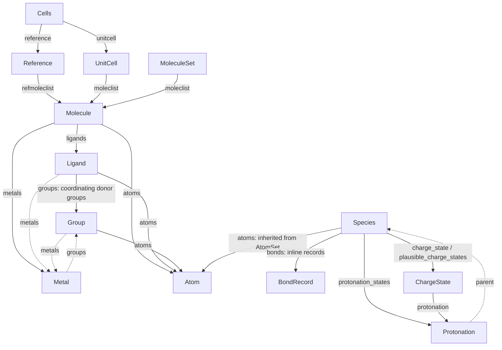

# Class structure

Data models for crystal cells, molecules, and charge assignment. `Cells`
bundles a `Reference` and an optional reconstructed `UnitCell`, each holding
its own molecules. `MoleculeSet` groups molecules for charge balancing and is
used by the XYZ workflow.

`Molecule` can contain `Ligand` objects and `Metal` atoms; `Group` represents a
ligand's coordinating fragment. `AtomSet` provides coordinates, connectivity,
and parent links. `Species` adds chemical analysis for `Molecule` and `Ligand`;
`Metal` extends `Atom` with metal-specific data.

## Inheritance

Each indented class inherits the data and methods of the class above it.

```text
BaseModel
├── Cell (+ ModelFileMixin)
│   ├── Reference
│   └── UnitCell
├── AtomSet
│   ├── Species
│   │   ├── Molecule (+ ModelFileMixin)
│   │   └── Ligand
│   └── Group
├── Atom
│   └── Metal
├── Cells (+ ModelFileMixin)
├── MoleculeSet (+ ModelFileMixin)
├── Bond
├── Protonation
└── ChargeState
```

The main inheritance paths are:

- **`Cell` → `Reference` / `UnitCell`:** Both share cell coordinates, lattice
  data, and processing methods. `Reference` builds the reference molecules;
  `UnitCell` holds the reconstructed molecules in the unit cell.
- **`AtomSet` → `Species` → `Molecule` / `Ligand`:** `AtomSet` provides atoms,
  coordinates, connectivity, and parent links. `Species` adds bonds,
  protonation, and charge analysis. `Molecule` and `Ligand` inherit both layers
  and add their own behavior.
- **`AtomSet` → `Group`:** `Group` represents a ligand fragment that coordinates
  to a metal. It inherits atom coordinates, connectivity, and parent links
  from `AtomSet`.
- **`Atom` → `Metal`:** A metal has the usual atom data plus coordination
  geometry, oxidation-state candidates, and spin.

`BaseModel` is the shared Pydantic base. `+ ModelFileMixin` marks classes that
can be saved to and loaded from files.

## Object relationships



Read each arrow as “this object has a link to that object.” Solid arrows show
stored objects or lists; dashed arrows show coordination links or a link back
to a parent.

- **Shared species data:** `Molecule` and `Ligand` inherit the atoms, bonds,
  protonation candidates, and charge states shown under `Species`.
- **Ligands and groups:** `Ligand.atoms` lists all atoms in a ligand.
  `Ligand.groups` lists the donor fragments that coordinate to metals.
- **Shared atoms:** A molecule, its ligands, and their groups refer to the same
  atom objects. For example, a donor atom appears in all three atom lists
  without being copied. `Molecule.metals` also refers to metal atoms already
  in `Molecule.atoms`; each `Metal` is a kind of `Atom`.
- **Parent links:** An atom or group can find its containing molecule and its
  atom positions there. Positions can differ between lists: ligand atom 0
  might be molecule atom 5. See [Parent links and persistence](#parent-links-and-persistence).
- **Charge candidates:** Each `ChargeState` links to a `Protonation` candidate
  and stores charges and molecular representations for both the protonated
  form and the original species.

## Files and roles

| File / class | Role |
| --- | --- |
| [cell.py](cell.py) · `Cell` | Shared cell data and processing methods |
| [reference.py](reference.py) · `Reference` | Molecules built from atom sites listed in the CIF; derives unique species and charge candidates |
| [unitcell.py](unitcell.py) · `UnitCell` | Reconstructed molecules in the unit cell; maps charge assignments from the reference |
| [cells.py](cells.py) · `Cells` | Bundles a reference, optional unit cell, and lattice data |
| [molecule_set.py](molecule_set.py) · `MoleculeSet` | Collection of molecules with charge balancing against a supplied total charge; used by the XYZ workflow |
| [atom_set.py](atom_set.py) · `AtomSet`, `AtomSetParentLink` | Shared geometry and connectivity for ordered atom collections; parent references with local-to-parent index maps |
| [species.py](species.py) · `Species` | Chemical analysis layer over `AtomSet`: inline bonds, protonation candidates, charge states, RDKit, and SMILES |
| [specie.py](specie.py) · `Specie` | Compatibility alias of `Species` for former imports and pickle module paths |
| [molecule.py](molecule.py) · `Molecule` | Connected molecule; separates complexes into metals and ligands |
| [ligand.py](ligand.py) · `Ligand` | Ligand atoms with hapticity and metal-specific denticity |
| [group.py](group.py) · `Group` | Coordinating donor fragment with hapticity, topology, and metal references; inherits `AtomSet` |
| [atom.py](atom.py) · `Atom`, `AtomParentLink` | Individual element, coordinates, connectivity, and charge; parent references with one index per parent |
| [metal.py](metal.py) · `Metal` | Metal atom with coordination geometry, oxidation state, and spin |
| [bond.py](bond.py) · `BondRecord` | Inline species-local bond data; `Bond` reads legacy objects |
| [protonation.py](protonation.py) · `Protonation` | Candidate protonation state |
| [charge_state.py](charge_state.py) · `ChargeState` | Candidate charge assignment linked to a `Protonation`, with protonated and original-species molecular representations |
| [__init__.py](__init__.py) | Public model exports, `Specie` alias, forward-reference resolution, and legacy JSON type registration |

## Parent links and persistence

A parent link records **where an atom or atom collection belongs** and
**which atom positions it occupies in that parent**. One object can have
several parents: a donor atom can belong to a molecule, a ligand, and a group.

For example, if a ligand contains molecule atoms `[5, 6, 8]`, its parent link
stores the molecule and that list. Ligand atom 0 is molecule atom 5, ligand
atom 1 is molecule atom 6, and ligand atom 2 is molecule atom 8.

- `Atom.parent_links` stores a parent and one atom index per link.
- `AtomSet.parent_links` stores a parent and a list of atom indices per link.

Use `add_parent()` to add or update a parent link and its atom indices.
For an `AtomSet`, this also follows the parent's links to record atom positions
in larger containers. For an `Atom`, only the given parent is added.

Use these methods to follow the links:

| Method | What it gives you |
| --- | --- |
| `get_parent("molecule")` | The containing molecule |
| `Atom.get_parent_index("molecule")` | This atom's position in the molecule |
| `AtomSet.get_parent_indices("molecule")` | The molecule positions of this collection's atoms, in local order |
| `inherit_adjacency("molecule")` | Copies connectivity for this collection's atoms from the molecule |

Models with `ModelFileMixin` support `save()` and `load()`, using JSON by
default. Parent objects are referenced by UUID in JSON. Loading restores the
links and shared objects, so an atom shared by a molecule and ligand remains
the same object after loading. Use `format="pickle"` for legacy pickle files.
