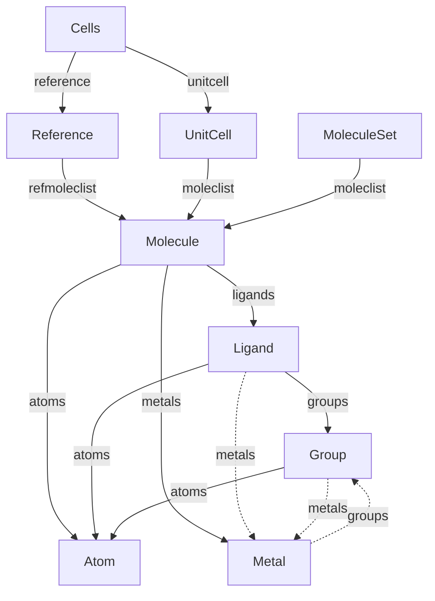

# Class structure

Pydantic models for crystal cells, molecules, and charge assignment.

## Inheritance

```text
BaseModel
├── Cell (+ ModelFileMixin)
│   ├── Reference
│   └── UnitCell
├── Specie
│   ├── Molecule (+ ModelFileMixin)
│   ├── Ligand
│   └── Group
├── Atom
│   └── Metal
├── Cells (+ ModelFileMixin)
├── MoleculeSet (+ ModelFileMixin)
├── Bond
├── Protonation
└── ChargeState
```

## Object relationships



Solid arrows show collections; dashed arrows show coordination links.
`Molecule.atoms`, `Ligand.atoms`, and `Group.atoms` share atom objects.
`Metal` is an `Atom` subclass.

## Files and roles

| File / class | Role |
| --- | --- |
| [cell.py](cell.py) · `Cell` | Shared cell data and processing methods |
| [reference.py](reference.py) · `Reference` | Molecules built from CIF Wyckoff sites; derives unique species and charge candidates |
| [unitcell.py](unitcell.py) · `UnitCell` | Reconstructed molecules in the full cell; maps charge assignments from the reference |
| [cells.py](cells.py) · `Cells` | Bundles a reference, optional unit cell, and lattice data |
| [molecule_set.py](molecule_set.py) · `MoleculeSet` | Molecules from one XYZ input, balanced against an input charge |
| [specie.py](specie.py) · `Specie` | Shared atom-set data: coordinates, formula, connectivity, and charge |
| [molecule.py](molecule.py) · `Molecule` | Connected molecule; separates complexes into metals and ligands |
| [ligand.py](ligand.py) · `Ligand` | Ligand atoms and coordinating donor groups |
| [group.py](group.py) · `Group` | Donor fragment with hapticity and denticity |
| [atom.py](atom.py) · `Atom` | Element, coordinates, connectivity, and parent indices |
| [metal.py](metal.py) · `Metal` | Metal atom with coordination geometry, oxidation state, and spin |
| [bond.py](bond.py) · `Bond` | Bond data for an atom pair |
| [protonation.py](protonation.py) · `Protonation` | Candidate protonation and added-atom data |
| [charge_state.py](charge_state.py) · `ChargeState` | Candidate charge assignment and molecular representations |

## Parent links and persistence

- `get_parent(subtype)` finds the containing object.
- `Atom.get_parent_index(subtype)` returns one atom index;
  `Specie.get_parent_indices(subtype)` returns a local-to-parent atom map.
- `Specie.add_parent(...)` composes ancestor index maps;
  `Atom.add_parent(...)` registers only the supplied parent.
- `inherit_adjacency(subtype)` copies the corresponding parent matrix subset.
- `ModelFileMixin` provides `save` / `load`, defaulting to JSON;
  legacy pickle files require `format="pickle"`.
- `__init__.py` resolves model forward references.
